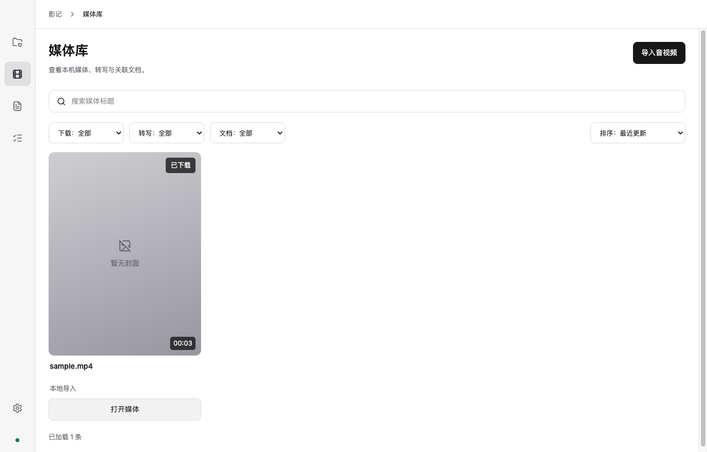
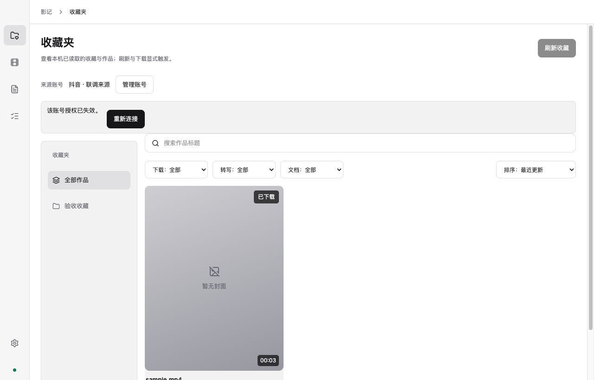
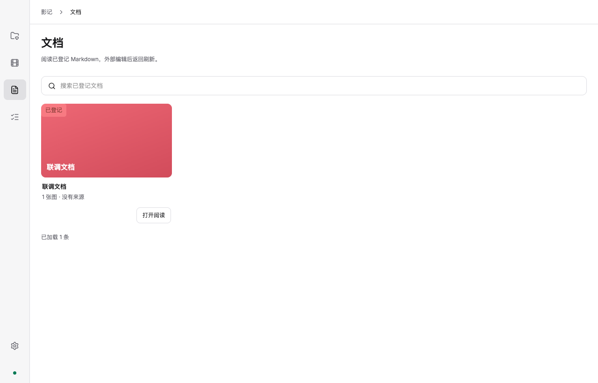

  

<h1 align="center">影记 · Yingji</h1>

<strong>把收藏的视频，变成自己的知识。</strong>

收藏整理 · 本地媒体 · 语音转写 · Markdown 笔记

  <a href="https://github.com/angrypandahu/yingji-releases/releases/latest">下载最新版</a> ·
  <a href="#开始使用">开始使用</a> ·
  <a href="https://github.com/angrypandahu/yingji-releases/releases">更新记录</a> ·
  <a href="https://github.com/angrypandahu/yingji-releases/issues">反馈问题</a>

影记是一款以本地资料为中心的桌面应用。把散落的收藏、音视频、转写与笔记放到一起：找到值得保留的内容，下载到本机，转成文字，再交给你使用的外部 Agent 整理为可继续编辑的 Markdown 文档。

**收藏 → 下载 / 导入 → 本地转写 → Agent 整理 → 关联文档**

*本文截图来自实际应用界面，使用演示账号、示例内容和示例封面；不包含个人收藏。*

## 下载

| 平台 | 安装包 | 说明 |
| --- | --- | --- |
| macOS · Apple Silicon | [下载 DMG](https://github.com/angrypandahu/yingji-releases/releases/download/v0.0.7/Yingji-0.0.7-macOS-arm64.dmg) | 适用于 M 系列芯片的 Mac |
| Windows · x64 | v0.0.7 安装包另行提供 | 请等待对应版本的 Windows 附件 |

当前安装包为 **v0.0.7**。其他附件与每次更新的具体说明，请查看 [Release 页面](https://github.com/angrypandahu/yingji-releases/releases/latest)。本版先提供 Mac Apple Silicon 安装包；Windows x64 另行构建。不提供 Intel Mac 或 Windows ARM 安装包。

## 从“收藏了”到“用起来”

### 01 · 按账号和收藏夹整理来源

连接抖音、小红书或 B 站来源账号，查看已读取的收藏与作品。按收藏夹浏览，也可以用标题、下载状态、转写状态和文档状态筛选。刷新收藏与下载都由你主动触发。

### 02 · 在本机保留内容，回到内容本身

下载平台内容，也可以导入已有音视频。媒体库统一显示下载状态；点击封面或标题进入详情，播放内容、提取音轨、截取画面，再查看相关转写和文档。

- **本地语音转写**：准备模型后，在本机把音频转为文字。
- **媒体与笔记关联**：文档保留对应媒体与转写的关联，方便继续查阅。
- **任务进度可见**：下载、准备与转写任务集中查看，失败时查看原因并处理。

### 03 · 用熟悉的 Agent 整理，留下可编辑的文档

通过 API / MCP 连接外部 Agent，让它根据媒体、转写和截帧整理笔记。影记负责资料管理与关联，**文档内容由外部 Agent 生成**，不是应用内置的一键写作服务。

Markdown 文件是文档正文，你可以继续用自己的编辑器修改。文档库集中展示已登记的笔记及其来源。

## 资料在本地，使用方式由你决定

| 能力 | 使用方式 |
| --- | --- |
| 本地资料库 | 在一个主文件夹中管理媒体、Markdown 和引用图片 |
| 本地转写 | 运行环境与模型首次准备需要联网；语音识别在本机执行 |
| 外部 Agent 接入 | 核对配对信息并批准后访问资料，随时可以撤销授权 |
| 本地使用 | 当前客户端暂不开放云端登录与同步功能 |

资料、来源登录凭据和模型保存在本机；当前客户端隐藏云端功能。外部 Agent 对资料的处理取决于你选择的工具与服务。

## 开始使用

1. **安装并打开影记**：Mac 下载 DMG，将 `Yingji.app` 拖到应用目录；Windows 运行 EXE 安装程序。
2. **选择资料位置并准备环境**：确认主文件夹，按界面提示准备运行环境；需要转写时准备对应模型。
3. **添加内容**：在「设置 → 来源账号」连接账号，再到收藏夹主动刷新；也可以从媒体库导入本地音视频。
4. **转写与整理**：在媒体详情中处理内容；需要生成笔记时，到「设置 → Agent 接入」连接外部 Agent。

首次准备需要联网，耗时取决于网络、模型大小和设备性能。平台内容能否读取或下载，也取决于账号状态、内容权限及平台限制。

v0.0.6 用户可以从应用内更新到 v0.0.7，本次提供完整和增量更新包。旧公开 v0.0.6 发行附件按维护者要求清理；后续 Mac 版本继续通过应用内更新入口获取，Windows 仍通过完整安装包覆盖更新。

## 更新与常见问题

<strong>升级后提示“环境尚未准备”，怎么办？</strong>

点击「开始准备」，重新检查所需运行环境。运行环境或资源清单变化时可能出现这一步；不需要为此清空资料或重新配对 Agent。

<strong>更新会删除已有资料吗？</strong>

安装包与本地资料、模型和运行环境分别保存。正常覆盖安装保留这些内容；不要主动删除自己的资料目录。Mac 的应用内更新入口位于「设置 → 通用 → 应用更新」，请先结束正在运行的任务。Windows 本版通过安装程序更新，不提供增量更新。

<strong>Mac 首次打开出现系统提示？</strong>

当前 macOS 安装包尚无 Apple Developer ID 公证。确认文件来自本仓库的正式 Release 后，按 macOS「隐私与安全性」提供的正常方式批准打开；无需关闭系统安全保护。

<strong>Release 中有很多附件，应该下载哪个？</strong>

首次安装选择上方对应平台的 DMG 或 EXE。Mac 不提供普通安装 ZIP；名称含 `update`、`delta` 的 ZIP 和 `update.json` 是应用更新使用的附件，无需手动解压安装。校验文件用于核对下载完整性，FFmpeg 源码包用于履行相关许可证要求。

## 反馈与发行说明

遇到问题，请在 [Issues](https://github.com/angrypandahu/yingji-releases/issues) 中提供应用版本、系统版本、复现步骤和错误提示。截图或日志中请去除账号凭据及私人内容。

此仓库提供影记的公开安装包、更新附件和发行说明，**不是应用源码仓库**。FFmpeg 等第三方组件的版权与许可随应用分发；对应源码见各版本的 Release 附件。
